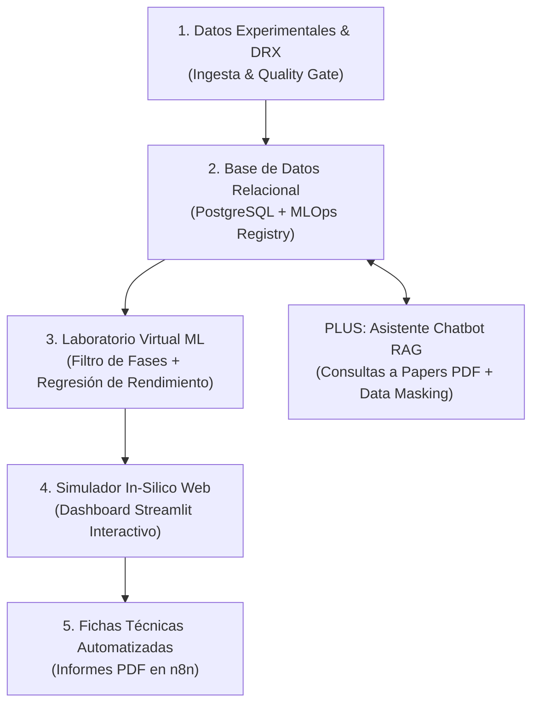

# 🧪 ALCheMy: Active Learning & Chemistry Modern-stack Yield-optimizer

> **Plataforma Integral de Data Science, MLOps e Inteligencia Artificial para la Optimización de Síntesis Química y Cristalografía de Materiales Avanzados (MOFs / POPs)**

---

## 🎯 Descripción del Proyecto
**ALCheMy** es una plataforma end-to-end diseñada para modernizar la investigación científica e industrial en química de materiales. Combina análisis exploratorio de datos, aprendizaje automático predictivo (*XGBoost / Random Forest*), optimización matemática continua (*SciPy*), procesamiento de señales espectrales (*DRX/PXRD*), un simulador *in-silico* en la web (*Streamlit*) y un copiloto conversacional RAG (*LangChain + pgvector*) para la consulta de literatura científica.



---

## 🧱 Arquitectura del Repositorio

```
ALCheMy/
├── README.md                     # Este archivo
├── CLAUDE.md                     # Guía de trabajo del repo para agentes de IA
├── docker-compose.yml            # Infraestructura empaquetada (n8n + PostgreSQL + pgAdmin)
├── Dockerfile.n8n                # Imagen n8n con Python/pandas embebido
├── Dockerfile.runners             # Task runner Python externo (sidecar n8nio/runners)
├── src/                          # Parsers deterministas (uno por técnica+extensión) + orquestador
│   ├── characterization_parser.py
│   └── parse_<tecnica>_<extension>.py
├── notebooks/                    # Notebooks de ingesta/ETL + especificaciones normativas de datos
│   ├── CHARACTERIZATION_DICTIONARY_SPEC.md   # Spec de las 9 técnicas de caracterización
│   └── DATA_DICTIONARY_AND_SCHEMA.md         # Esquema de synthesis_experiments
├── n8n_workflows/                # Export JSON del workflow maestro de ingesta
├── workflows/                    # Matrices de gobernanza (permission_matrix, error_payloads_matrix)
├── scripts/                      # DDL inicial de PostgreSQL + utilidades
├── app/                          # Dashboard Streamlit de verificación masiva
├── docker/                       # Configuración del task runner Python externo de n8n
└── data/, backups/, methodology/, scratch/   # Fuera de git - ver Privacidad más abajo
```

### 🔏 Privacidad de los datos

Este es un laboratorio real, no un dataset sintético. `data/` (archivos crudos de instrumento y datos de síntesis), `backups/`, `methodology/` (bitácora y notas de laboratorio) y `.env` están excluidos de git a propósito — solo se publican código, esquema, notebooks de especificación y el JSON del workflow. Nunca se sube a este repositorio ni se envía a un servicio externo un parámetro de síntesis, nombre de ligando o valor de `.env` real.

---

## 🛠️ Stack Tecnológico
* **Lenguaje Principal:** Python 3.11+
* **Data Science & ML:** `Pandas`, `NumPy`, `Scikit-Learn`, `XGBoost`, `SciPy` (`signal`, `optimize`)
* **Base de Datos & MLOps:** `PostgreSQL` / `Supabase`, `pgvector`, Registro de versiones `model_version_log`
* **Dashboard Interactivo:** `Streamlit`, `Plotly` (Superficies de respuesta 3D y gráficos interactivos)
* **IA Generativa & RAG:** `LangChain` / `LlamaIndex`, embeddings vectoriales
* **Automatización:** `n8n`, Webhooks

---

## 🔐 Data Governance & Compliance

ALCheMy no es solo un pipeline de ingesta: es un sistema de registro para datos de laboratorio, y se ha diseñado con los mismos principios que exigiría un entorno regulado de I+D. No ostenta ninguna certificación formal, pero varias decisiones de arquitectura aplican directamente el espíritu de normas reconocidas en gestión de calidad de datos, seguridad de la información e IA responsable:

| Principio | Norma / marco de referencia | Cómo se aplica en ALCheMy |
| :--- | :--- | :--- |
| **Trazabilidad del dato de origen** | ISO/IEC 17025 (competencia de laboratorios de ensayo y calibración) | Cada medida conserva su `raw_file_path` (archivo físico original), un hash MD5 anti-duplicado (`file_hash`), y timestamps **reales** extraídos del propio instrumento (nunca generados por el sistema) — desde la fecha de escaneo de un XRD hasta la calibración registrada de una TGA. Ningún dato numérico se deriva sin dejar constancia de su procedencia (`magnification_source`, `bet_fit_valid`, etc.) |
| **Control de acceso y gestión de riesgo por acción** | ISO/IEC 27001 (gestión de seguridad de la información) | Lista blanca de investigadores autorizados (`authorized_researchers`) que filtra la ingesta antes de tocar la base de datos; cada acción del agente automatizado está clasificada en un nivel de autonomía L0–L4 (`workflows/permission_matrix.csv`), desde lectura sin riesgo (L4) hasta acciones que requieren aprobación humana explícita (L2) o están prohibidas por diseño (L0, p. ej. borrado destructivo) |
| **Supervisión humana de decisiones de IA (Human-in-the-Loop)** | Marcos de gobernanza de IA (p. ej. EU AI Act, NIST AI RMF) | Toda extracción por IA con confianza declarada por debajo del umbral (85%) se detiene y espera aprobación explícita por email antes de insertarse en la base de datos; ningún agente de IA escribe directamente en la tabla de auditoría — `audit_log` se escribe siempre de forma determinista, nunca por un LLM |
| **Disciplina anti-alucinación** | Buenas prácticas de IA responsable | Los prompts de los agentes prohíben explícitamente inventar valores no presentes en el documento/imagen; cuando un ajuste instrumental es inválido (p. ej. un área BET negativa) se registra tal cual con sus flags de validez en vez de ocultarlo o corregirlo silenciosamente; los campos derivados por cálculo (Kubelka-Munk, % de pérdida de masa) están siempre etiquetados aparte del dato crudo, nunca lo sustituyen |
| **Interoperabilidad y reutilización del dato (FAIR)** | Principios FAIR (Findable, Accessible, Interoperable, Reusable) | Esquema `data_json` uniforme (`header_metadata` + `raw_data`) en JSONB con índice GIN para las 9 técnicas de caracterización; la tabla `data_dictionary` documenta cada campo como dato consultable, no como documentación externa que pueda desincronizarse |
| **Confidencialidad por diseño** | RGPD / buenas prácticas de minimización de datos | `data/`, `backups/`, `methodology/`, `.env` y las credenciales quedan fuera del control de versiones; la capa RAG planificada incluye un paso de enmascarado/seudonimización de ligandos antes de cualquier llamada a un LLM externo, para que ninguna síntesis propietaria salga del perímetro del laboratorio sin control |
| **Registro de auditoría inmutable y verificable** | ISO/IEC 27001 (registro de eventos) | Toda acción automatizada — éxito o fallo — queda registrada en `audit_log` con `verdict` / `cause` / `result` tipados y consistentes (`workflows/error_payloads_matrix.csv`), permitiendo reconstruir por qué se aceptó o rechazó cualquier medida sin depender de logs de texto libre |

Estas prácticas se aplican de forma consistente en las 9 técnicas de caracterización soportadas (PXRD, VT-XRD, TGA, FTIR, Adsorción/BET, UV-Vis, SEM, FESEM, TEM) y en las dos rutas de extracción con IA (informes PDF de ICP/EA, análisis de micrografías electrónicas).
