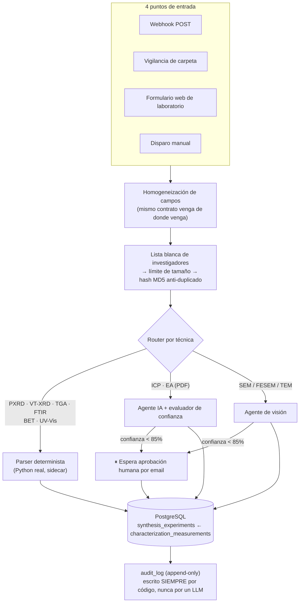

# 🧪 ALCheMy

> **Plataforma de datos gobernada para un laboratorio real de química de materiales (MOFs / POPs).**
> De 20 años de cuadernos de laboratorio, un Excel maestro y ~5.700 ficheros crudos de instrumento, a una única fuente de verdad en PostgreSQL — con trazabilidad, auditoría y validación humana.

---

## 🎯 El problema

Un laboratorio de síntesis de materiales genera datos que **no se parecen a los de una empresa**:

- Cada instrumento escribe en su **formato propietario**: XML de PANalytical, contenedores ZIP de Bruker, texto en UTF-16 de una termobalanza, CSV con coma decimal.
- El conocimiento de qué funcionó vive en **cuadernos manuscritos** y en la cabeza del investigador.
- Los datos son **caros e irrepetibles**: una medida no se vuelve a hacer porque se haya perdido el fichero.
- Y en I+D, **un dato sin procedencia no vale nada**: si no puedes llegar al fichero original del instrumento, no puedes defender el resultado.

ALCheMy convierte ese archivo disperso en una base de datos consultable, sin perder por el camino ni un byte de trazabilidad.

---

## ✅ Estado actual — qué funciona hoy

> Este bloque describe **únicamente lo que está implementado y verificado**. Lo planificado está más abajo, claramente separado. Ver también el [historial de decisiones](#-decisiones-de-ingeniería-destacadas).

| Componente | Estado |
|---|---|
| Stack en Docker Compose (n8n + PostgreSQL/pgvector + pgAdmin + sidecar de runners) | ✅ Funcionando |
| Esquema relacional gobernado con comentarios SQL nativos | ✅ `scripts/sql/init_db.sql` |
| 7 parsers deterministas de formatos de instrumento | ✅ `src/parse_*.py` |
| Workflow de ingesta con 4 puntos de entrada, control de duplicados y gobernanza | ✅ 66 nodos, `n8n_workflows/` |
| Ejecución de Python real (pandas/numpy) desde n8n vía task runner externo | ✅ Verificado extremo a extremo |
| Registro de auditoría append-only con veredictos tipados | ✅ `audit_log` |
| Rama de extracción por IA con Human-in-the-Loop bajo umbral de confianza | ✅ ICP/EA (PDF) y microscopía |
| Notebooks de ingesta del Excel maestro con ingeniería de características | ✅ `notebooks/01-03` |

### Arquitectura real



### Dos rutas de ingesta, un solo modelo de datos

```
Excel maestro  ──► notebook 01 ──► UPSERT ──► synthesis_experiments   (padre, 1 fila por síntesis)
                                                     ▲ FK sample_code
ficheros crudos ──► parsers ──► n8n ──► characterization_measurements (hija, 1 fila por medida)
```

El **UPSERT** (`ON CONFLICT DO UPDATE`) es deliberado: hay dos productores independientes escribiendo en la misma tabla, y recargar el Excel nunca debe borrar lo que escribió el workflow.

---

## 🔬 El contrato de datos: la abstracción que sostiene todo

Los siete parsers leen formatos que no tienen **nada** en común. Lo que sí es común es lo que devuelven:

```python
{
  "sample_code": "RS1883", "technique": "PXRD", "measurement_tag": "as_synthesized",
  "operator_name": ..., "instrument_name": ..., "file_name": ..., "raw_file_path": ...,
  "data_json": {
      "header_metadata": { ... ajustes reales del instrumento ... },
      "raw_data": { "x_label": "2theta_deg", "y_label": "intensity_counts",
                    "x": [...], "y": [...] }
  }
}
```

Ese diccionario se guarda como **JSONB con índice GIN**, así que una misma consulta sirve para las 9 técnicas. La especificación normativa vive en [`notebooks/CHARACTERIZATION_DICTIONARY_SPEC.md`](notebooks/CHARACTERIZATION_DICTIONARY_SPEC.md) — **la regla es cambiar la spec primero y el código después.**

| Técnica | Formato | Lo no trivial |
|---|---|---|
| PXRD | `.xrdml` (XML PANalytical) | Namespaces a eliminar; el 2θ **no está en el fichero** — se reconstruye por `linspace` porque sólo se almacenan las cuentas |
| VT-XRD / PXRD | `.brml` (contenedor ZIP de Bruker) | Más de 2 entradas `RawData*.xml` ⇒ es una serie de temperatura, si no es un barrido único |
| TGA | `.txt` (TA SDT Q600) | UTF-16 con fallback a latin1; 7 señales simultáneas |
| FTIR | `.csv` | Separador coma o punto y coma, tolerante a coma decimal |
| Adsorción / BET | `.xls` (Micromeritics) | Flags de validez del ajuste, no se oculta un área negativa |
| UV-Vis | `.asc` / `.csv` | Kubelka-Munk y vectores de Tauc derivados en el parseo, **etiquetados aparte del dato crudo** |
| SEM / FESEM / TEM | `.jpg` + `.txt` compañero | Metadatos Hitachi; el análisis por visión queda a `None` para que lo rellene un agente después |

---

## 🔐 Gobernanza del dato

ALCheMy no es sólo un pipeline: es un **sistema de registro** para datos de laboratorio, diseñado con los principios que exigiría un entorno regulado de I+D. No ostenta ninguna certificación formal, pero varias decisiones de arquitectura aplican directamente el espíritu de normas reconocidas.

| Principio | Marco de referencia | Cómo se aplica |
| :--- | :--- | :--- |
| **Trazabilidad del dato de origen** | ISO/IEC 17025 | Cada medida conserva su `raw_file_path`, un hash MD5 anti-duplicado y **timestamps reales extraídos del instrumento**, nunca generados por el sistema. Ningún dato derivado se calcula sin dejar constancia de su procedencia |
| **Control de acceso y riesgo por acción** | ISO/IEC 27001 | Lista blanca `authorized_researchers` que filtra antes de tocar la base; cada acción del agente tiene un nivel de autonomía L0–L4 declarado en [`workflows/permission_matrix.csv`](workflows/permission_matrix.csv), desde lectura autónoma (L4) hasta borrado destructivo **prohibido por diseño** (L0) |
| **Supervisión humana (HITL)** | EU AI Act · NIST AI RMF | Toda extracción por IA con confianza declarada bajo el 85% se detiene y espera aprobación explícita por email. **Ningún LLM escribe en la tabla de auditoría** — `audit_log` se escribe siempre de forma determinista |
| **Disciplina anti-alucinación** | Buenas prácticas de IA responsable | Los prompts prohíben inventar valores ausentes del documento; un ajuste instrumental inválido se registra **tal cual con sus flags**, no se corrige en silencio; los campos derivados van siempre etiquetados aparte del dato crudo |
| **Interoperabilidad (FAIR)** | Principios FAIR | Contrato `data_json` uniforme para las 9 técnicas; la tabla `data_dictionary` documenta cada campo **como dato consultable**, no como documentación externa que se desincroniza |
| **Confidencialidad por diseño** | RGPD · minimización de datos | `data/`, `backups/`, `methodology/` y `.env` fuera de control de versiones; la capa RAG planificada incluye seudonimización de ligandos antes de cualquier llamada a un LLM externo |
| **Auditoría inmutable** | ISO/IEC 27001 (registro de eventos) | Toda acción, éxito o fallo, se registra con `verdict` / `cause` / `result` tipados según [`workflows/error_payloads_matrix.csv`](workflows/error_payloads_matrix.csv) — reconstruible sin depender de logs de texto libre |

---

## 🧭 Decisiones de ingeniería destacadas

Las decisiones no obvias, con su porqué. Es la parte del proyecto de la que más he aprendido.

**Pérdida silenciosa de campos en el punto de convergencia.**
Las tres rutas de entrada desembocaban en un nodo de PostgreSQL cuyo `RETURNING email, role, active` **sustituía el ítem completo**, borrando el resto de campos y el binario del fichero. Ocurría en dos puntos distintos por la misma causa. Resuelto sin código: nodos `Set` que normalizan el ítem venga de donde venga, y `Merge` nativos que recomponen lo que Postgres descarta — sustituyendo un parche previo que dependía de referencias fijas a nodos concretos.

**Python real dentro de n8n.**
El nodo `Execute Command` no existe en esta versión (confirmado en los logs: `Unrecognized node type`), y los nodos `Code` en Python corren en un entorno aislado sin librerías científicas. Solución: un sidecar `n8nio/runners` en **modo externo** con pandas/numpy/openpyxl/xlrd en su venv y explícitamente en la lista blanca (`N8N_RUNNERS_EXTERNAL_ALLOW`), que viene vacía por defecto como postura de seguridad deliberada.

**Rutas idénticas en local y en cloud.**
Los bind mounts exponen `./data`, `./src` y `./n8n_workflows` en rutas de contenedor fijas. Es a propósito: `raw_file_path` se persiste como trazabilidad, y si la ruta cambiara al desplegar, el linaje del dato dejaría de resolver.

**Fallback silencioso detectado.**
El modelo de difractómetro salía idéntico en todas las muestras: el código buscaba una etiqueta XML que **no existe** en los exports de PANalytical —el dato va como texto libre en un bloque de comentarios— y caía a un valor por defecto sin avisar. Un valor por defecto silencioso es peor que un error: contamina los datos sin dejar rastro.

---

## 🗺️ Roadmap — lo que aún NO está construido

> Separado a propósito de lo anterior. Nada de esta sección está implementado todavía.

| Fase | Qué | Estado |
|---|---|---|
| **Ingesta masiva** | Tabla de cola en Postgres con `SELECT ... FOR UPDATE SKIP LOCKED` para reintento quirúrgico sobre los ~5.700 ficheros | 🔜 Siguiente |
| **Descriptores PXRD** | Extracción automática de métricas de cristalinidad: línea base arPLS rígida que preserva el halo amorfo, detección de picos por estadística de Poisson, conversión a distancia interplanar | 🔜 Siguiente |
| **Machine learning** | Clasificación de condiciones de síntesis → categoría de resultado, con un modelo interpretable y validación **agrupada o temporal** (nunca split aleatorio: hay correlación entre muestras de la misma campaña) | 📋 Planificado |
| **Asistente RAG** | Agente con tres recuperadores: SQL parametrizado para hechos exactos, búsqueda híbrida vector+BM25 sobre documentos, y grafo derivado para relaciones | 📋 Planificado |
| **Aplicación web** | Panel de exploración y simulador in-silico | 📋 Planificado |

**Por qué el ML no está hecho todavía:** porque aún no existe la variable objetivo. Construirla —descriptores, validación, etiquetado por aprendizaje activo— es el trabajo real. Entrenar antes de eso significaría inventarse una etiqueta o validar con un split que produce métricas falsamente buenas.

---

## 🛠️ Stack

**Infraestructura** · Docker Compose · PostgreSQL 16 + pgvector · pgAdmin · n8n + sidecar de task runners
**Datos** · Python 3.11 · pandas · numpy · SQLAlchemy · psycopg2 · openpyxl
**Automatización** · n8n (webhooks, formularios, agentes con tool calling, HITL)
**Previsto** · procesamiento de señal para descriptores PXRD · modelo de clasificación interpretable · aplicación web de exploración

---

## 🚀 Puesta en marcha

```bash
cp .env.example .env          # rellenar credenciales y puertos
docker compose up -d          # n8n :5678 · PostgreSQL :5432 · pgAdmin :8080

# Ingesta masiva del data lake
python src/ingest_datalake_to_postgres.py

# Enviar un fichero al webhook de n8n
python scripts/trigger_n8n_webhook.py -f <fichero> -t PXRD -s RS1883
```

> `scripts/sql/init_db.sql` se ejecuta **sólo en la primera creación del volumen** `postgres_data`. Cambiar el DDL sobre una base existente exige aplicar el delta a mano.

---

## 🗂️ Estructura

```
ALCheMy/
├── docker-compose.yml         Infraestructura completa
├── Dockerfile.n8n             Imagen n8n con Python embebido
├── Dockerfile.runners         Sidecar de ejecución Python
├── src/                       7 parsers deterministas + orquestador de ingesta
├── notebooks/                 ETL del Excel maestro + especificaciones normativas
│   ├── CHARACTERIZATION_DICTIONARY_SPEC.md    Contrato de las 9 técnicas
│   └── DATA_DICTIONARY_AND_SCHEMA.md          Esquema de síntesis
├── n8n_workflows/             Export del workflow maestro (66 nodos)
├── workflows/                 Matrices de gobernanza (permisos, errores tipados)
├── scripts/                   DDL inicial + utilidades
├── app/                       Panel Streamlit de verificación
└── data/ · backups/ · methodology/     Fuera de git — ver Privacidad
```

---

## 🔏 Privacidad

Este es un **laboratorio real, no un dataset sintético**. Quedan deliberadamente fuera de git los datos crudos de instrumento, los parámetros de síntesis, la bitácora de proyecto y las credenciales. Sólo se publica código, esquema, especificaciones y el JSON del workflow.

**Nunca se sube a este repositorio ni se envía a un servicio externo un parámetro de síntesis, un nombre de ligando o un valor real de `.env`.**
