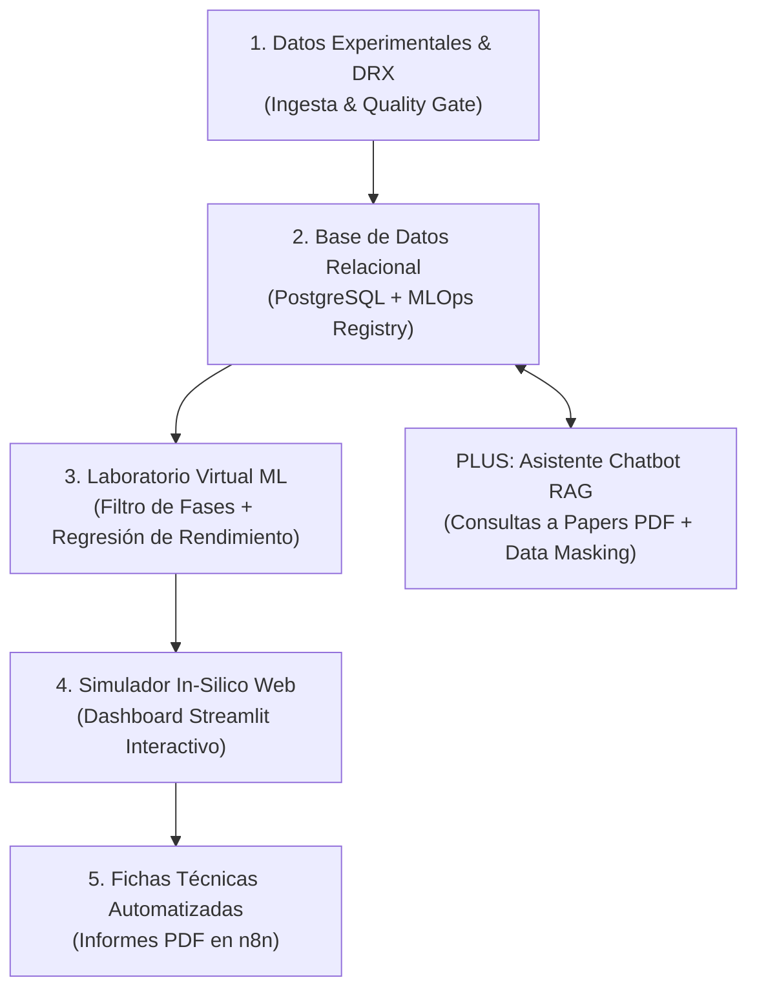

# 🧪 ALCheMy: Active Learning & Chemistry Modern-stack Yield-optimizer

> **Plataforma Integral de Data Science, MLOps e Inteligencia Artificial para la Optimización de Síntesis Química y Cristalografía de Materiales Avanzados (MOFs / POPs)**

---

## 🎯 Descripción del Proyecto
**ALCheMy** es una plataforma end-to-end diseñada para modernizar la investigación científica e industrial en química de materiales. Combina análisis exploratorio de datos, aprendizaje automático predictivo (*XGBoost / Random Forest*), optimización matemática continua (*SciPy*), procesamiento de señales espectrales (*DRX/PXRD*), un simulador *in-silico* en la web (*Streamlit*) y un copiloto conversacional RAG (*LangChain + pgvector*) para la consulta de literatura científica.



---

## 🧱 Arquitectura del Repositorio

```
ALCheMy/
├── INDEX_RECURSOS_Y_TEORIA.md    # Ficha Maestra con enlaces a las fuentes de conocimiento
├── PLAN_DE_TRABAJO.md            # Hoja de ruta progresiva por fases (MVP a Cloud)
├── docs/                         # Documentación y Manuales
│   └── MANUAL_BUENAS_PRACTICAS_MLOPS_SAAS.md
├── data/                         # Gestión de datos (raw / processed)
├── notebooks/                    # Jupyter Notebooks de EDA, ML y DRX
├── src/                          # Código fuente Python modular (.py)
├── app/                          # Dashboard interactivo en Streamlit
├── reports/                      # Informes y fichas técnicas PDF generadas
└── docker-compose.yml            # Infraestructura empaquetada
```

---

## 🛠️ Stack Tecnológico
* **Lenguaje Principal:** Python 3.11+
* **Data Science & ML:** `Pandas`, `NumPy`, `Scikit-Learn`, `XGBoost`, `SciPy` (`signal`, `optimize`)
* **Base de Datos & MLOps:** `PostgreSQL` / `Supabase`, `pgvector`, Registro de versiones `model_version_log`
* **Dashboard Interactivo:** `Streamlit`, `Plotly` (Superficies de respuesta 3D y gráficos interactivos)
* **IA Generativa & RAG:** `LangChain` / `LlamaIndex`, embeddings vectoriales
* **Automatización:** `n8n`, Webhooks
