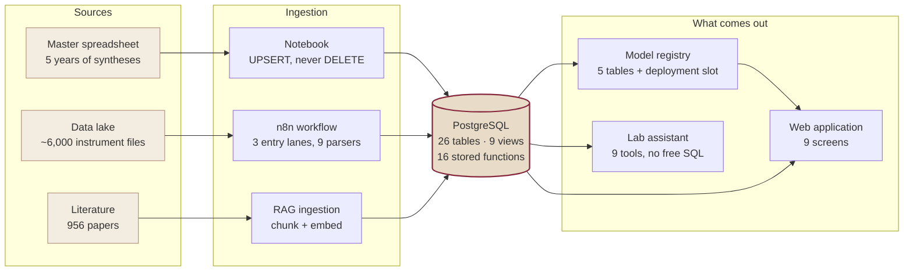

# Architecture

What the system is made of, and why each piece is where it is.

---

## The shape of it



---

## Two ingestion lanes, one table

The parent table holds one row per synthesis attempted; the child table one row
per instrument file measured, joined by sample code with `ON DELETE CASCADE`.

Those two lanes are written by different processes at different times, which is
the whole reason the load is an UPSERT. The cascade is also why an apparently
simple cleanup — deleting rows that should not exist — has to be done in the
right order, or it takes a thousand measurements with it.

## The parser contract

Nine instrument formats, one dictionary shape out:

```
{sample_code, technique, measurement_tag, operator_name,
 instrument_name, file_name, raw_file_path,
 data_json: { header_metadata: {...}, raw_data: {x_label, y_label, x, y} }}
```

Stored as JSONB with a GIN index, so a query can span every technique without
knowing anything about the instrument. The formats handled include PANalytical
XML, Bruker ZIP containers (which encode a temperature series by how many entries
they contain), UTF-16 thermogravimetry exports, decimal-comma-tolerant CSV,
Micromeritics spreadsheets, and microscope images with a sidecar file.

Two implementations exist — one in Python for the notebooks and the bulk backfill,
one embedded in the workflow — and a script keeps them in sync rather than trust
that they stayed that way.

## The schema, in seven families

| Family | What it holds |
|---|---|
| Laboratory record | one row per synthesis, one per measurement |
| Chemistry reference | elements, ions, linkers, and a citation for every property |
| Signal & ground truth | 29 descriptors per diffractogram, and the human verdicts |
| Model registry | dataset snapshot, recipe, features, metrics, binary |
| Literature corpus | catalogue, passages, vectors, context sentences |
| Knowledge graph | samples, metals, linkers, modulators, measurements |
| Governance | dictionary, audit log, whitelist, agent transcripts |

Every column carries a native `COMMENT`, and those comments are also exposed as
rows in a dictionary table — so the web application and the AI agent read the
documentation *from the database* instead of carrying a copy that can drift.

Coverage is checked by a script that exits non-zero if any object is
undocumented. The target is 100 %, and the reason is sharper than tidiness: an
incomplete dictionary makes *undocumented column* and *column that does not
exist* look identical to whatever is reading it.

## The model registry

A trained model is kept as five related tables rather than a file:

- **dataset** — the literal SQL that selected the rows, plus its SHA-256, so that
  two models sharing a query but differing in row count are detectably different;
- **model** — algorithm, hyperparameters, seed, library versions, git commit,
  status;
- **features** — every input column with its position in the contract, and every
  excluded one with its reason;
- **metrics** — long format, so a new metric never means altering the schema;
- **artifact** — the serialised pipeline with a checksum verified on load.

What is running is decided by a **deployment slot** the service queries, not by a
name written into the code.

## Retrieval

Three retrievers over the same passages, added in this order because each fixed
something specific the previous one missed: dense vectors with an HNSW index,
full-text with a GIN index, and their fusion by reciprocal rank. A fourth layer —
reranking — is wired and disabled, because the only option available would send
passage text to a third party.

The assistant reaches the laboratory through nine stored functions, never through
SQL it composes itself.

## The web application

Nine screens following the CRISP-DM arc. Every published figure is generated from
the live database at build time by a script, never typed into the page. That rule
exists because it was broken once: a table of models was maintained by hand and
went on claiming a superseded model was active after a new one had been deployed.

## Running it

```bash
docker compose up -d      # n8n, PostgreSQL, pgAdmin, task runners
```

Four host paths are bind-mounted into the containers and cannot move without
updating the compose file: the data lake, the source tree, the workflow exports,
and the database bootstrap SQL. A checker reports which one is missing if the
stack refuses to start.
