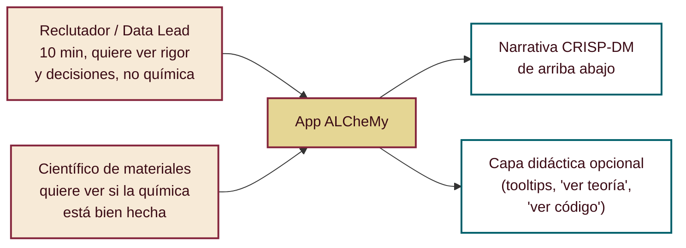
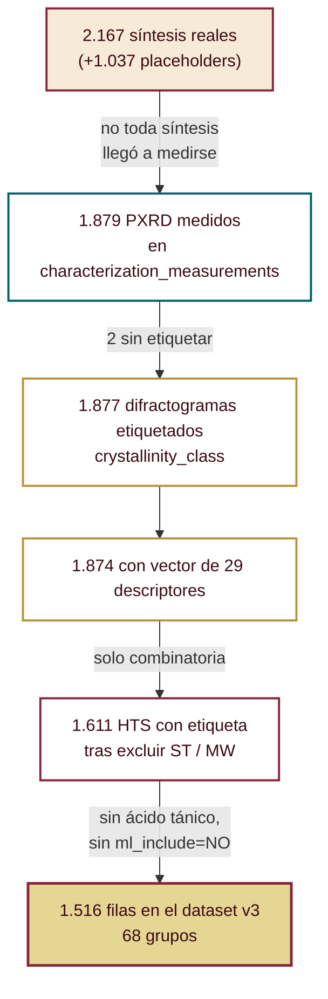
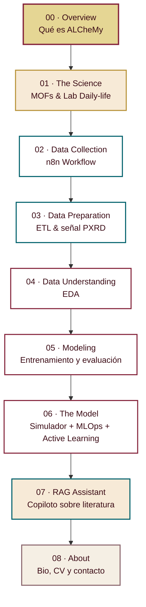
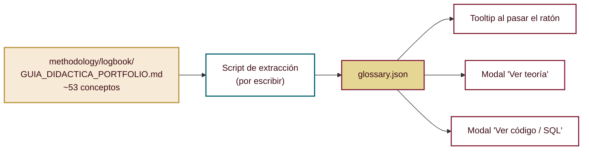
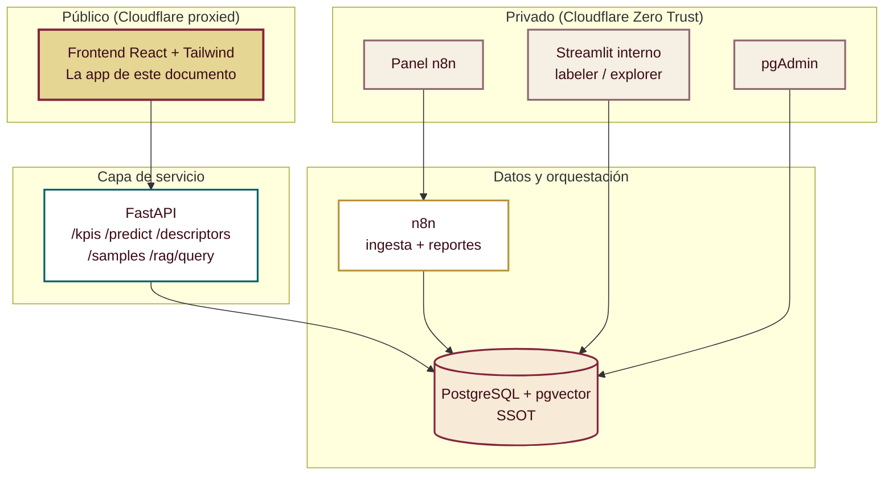
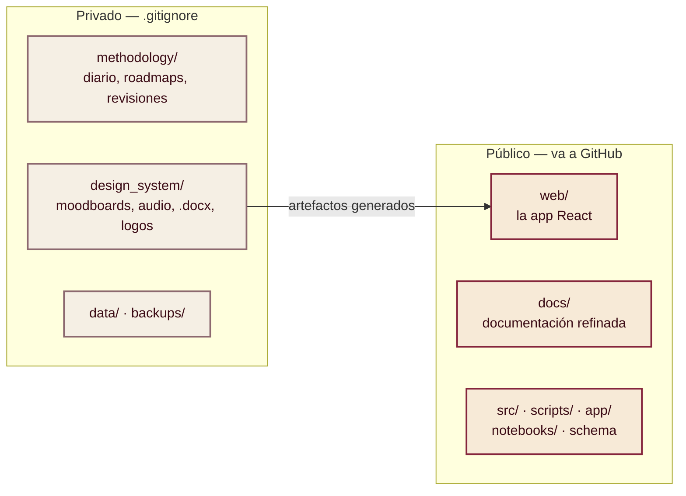

# 🗺️ Roadmap Maestro de la App Web ALCheMy — Arquitectura de pantallas + Guión de contenido

> **Fecha de unificación:** 2026-09-01
> **Qué es esto:** el documento único donde vive *qué pantallas tiene la app* y *qué se cuenta
> exactamente en cada una*. Sustituye a la información dispersa en cuatro sitios distintos.
> **Qué NO es:** no es el sistema de diseño visual (eso sigue siendo `design_system/style_guide.yaml`)
> ni el roadmap de infraestructura (eso sigue en `methodology/roadmaps/ROADMAP_IDENTIDAD_VISUAL_Y_APP.md`,
> secciones 6–9).
>
> ⚠️ **Antes de publicar este archivo en GitHub, resolver la decisión D6 (sección 9).**

---

## 0. Cómo leer este documento

Está pensado para leerse **de arriba abajo una vez**, y después consultarse por pantallas.

- **Secciones 1–3**: contexto, qué había disperso, y las incoherencias que se han encontrado al
  juntarlo todo. Esto es lo primero que hay que validar, porque el resto depende de ello.
- **Sección 4**: la arquitectura de pestañas ya decidida.
- **Sección 5**: el guión, pantalla por pantalla. Es el grueso del documento.
- **Secciones 6–8**: capas transversales (didáctica, privacidad, identidad, técnica).
- **Sección 9**: las decisiones que siguen abiertas y **necesitan a Rubén**.
- **Sección 10**: el plan de ejecución en fases.

**Semáforo de estado del contenido**, usado en toda la sección 5:

| Marca | Significado |
|---|---|
| ✅ | El texto ya está escrito (normalmente en `Guion_web.docx`) y sirve tal cual o casi |
| 🟡 | Está esbozado en notas, pero hay que redactarlo de verdad |
| 🔴 | No existe todavía: hay que escribirlo desde cero |
| ⚠️ | Hay una decisión abierta que bloquea el contenido (ver sección 9) |

---

## 1. Qué es la app y para quién

ALCheMy es a la vez un **laboratorio real** y un **portfolio**. La app tiene que servir a dos
audiencias que leen muy distinto, y esa tensión condiciona todas las decisiones de diseño:



**La regla que resuelve la tensión:** el texto principal de cada pantalla lo tiene que entender un
reclutador sin química. Todo lo que sea profundidad química o matemática vive en **capas opcionales**
(tooltip, modal "Ver teoría", modal "Ver código"). Nadie tiene que hacer scroll por encima de algo
que no le interesa para llegar a lo que sí.

---

## 2. Qué había disperso y qué se ha unificado

| Documento | Qué aportaba | Estado tras esta unificación |
|---|---|---|
| `design_system/Guion_web.docx` | **El guión real de contenido**, escrito por Rubén, con las pestañas alineadas a CRISP-DM y textos ya redactados en inglés | ✅ **Fuente principal** de la sección 5. Absorbido aquí |
| `design_system/GUIÓN_PANTALLAS_WEB.md` | Estructura de 7 pestañas tipo portfolio + ideas de componentes interactivos | ⚠️ **Superado** en su estructura. Se rescatan sus ideas de componentes |
| `methodology/roadmaps/ROADMAP_IDENTIDAD_VISUAL_Y_APP.md` | Elección de herramientas, fases de despliegue, Cloudflare, audio ambiental | 🔵 **Sigue vigente** en sus secciones 6–9 (infraestructura). Sus secciones 1–2 (paleta) están superadas |
| `design_system/style_guide.yaml` | Design tokens: colores, tipografía, componentes | ✅ **Fuente única** de identidad visual. Sin cambios |
| `design_system/PROMPT_MAESTRO_LOVABLE.md` | Prompt para generar el frontend | 🔴 **Hay que regenerarlo** — está construido sobre la estructura de pestañas antigua |
| `design_system/preview_theme.html` | Muestra visual de la paleta y los estilos | ✅ Vigente como referencia visual |
| `design_system/preview_n8n_canvas.html` | Canvas interactivo del workflow n8n | 🟡 Vigente pero **necesita rehacerse** (ver pantalla 02) |
| `methodology/logbook/GUIA_DIDACTICA_PORTFOLIO.md` | ~53 conceptos explicados en lenguaje llano | ✅ **Fuente de la capa didáctica** (tooltips y modales) |

---

## 3. Incoherencias detectadas y decisión tomada

Al cruzar los documentos aparecen siete contradicciones. Ninguna es grave, pero todas se propagarían
al frontend si no se cierran ahora.

### 3.1 Los KPIs de la portada están mal contados ✅ resuelto (auditoría 2026-09-01)

Los documentos de diseño repiten `4.843 difractogramas` y `1.870 síntesis`. Un recuento crudo de
filas da números distintos y **más altos**, lo que hizo saltar la alarma. Se auditó la base de datos
entera. **Conclusión: los datos están sanos; lo que estaba mal era la forma de contarlos.**

#### El malentendido nº 1 — `pxrd_labels` no es "un difractograma por fila"

La clave primaria es `(file_hash, label_type)`: **una fila por juicio**, no por patrón.

| `label_type` | Filas |
|---|---|
| `crystallinity_class` | 1.877 |
| `multiphase_suspected` | 1.164 |
| `oxide_flag` | 1.164 |
| `incipient_subtype` | 645 |
| `ml_include` | 114 |
| **Total** | **4.964** |

→ **1.877 difractogramas etiquetados**, con 4.964 juicios sobre ellos.
No hay ni un duplicado: `count(DISTINCT file_hash) = 1.877`.

#### El malentendido nº 2 — `synthesis_experiments` incluye filas-muleta

| Categoría | Filas |
|---|---|
| Síntesis reales | **2.167** |
| Placeholders (`synthesis_type = 'PENDING_RECORD'`, `metal_center = 'UNKNOWN'`) | 1.037 |
| **Total** | **3.204** |

Los 1.037 se crearon **todos el 2026-08-25**, en la ingesta masiva, para códigos de muestra que
aparecían en un fichero de caracterización pero no existían aún en la tabla de síntesis: sin ellos
la FK habría bloqueado la carga. Llevan `researcher_name = 'UNKNOWN'` y la fecha de ingesta como
`synthesis_date`. **2.167 es el número real de síntesis**, y coincide con la estimación de Rubén
(~2.175).

> 📌 `CLAUDE.md` dice que los placeholders llevan "química ficticia Ni/Pireno". **Ya no es cierto:**
> hoy llevan `UNKNOWN`/`UNKNOWN` y `synthesis_type = 'PENDING_RECORD'`. Corregir esa frase.

#### El embudo real, verificado extremo a extremo



**Cada escalón baja, como tiene que ser.** Que haya menos PXRD (1.879) que síntesis (2.167) es
exactamente lo que Rubén esperaba: no toda síntesis llegó al difractómetro.

#### ¿Afectó esto al Machine Learning? **No.**

Verificado por consulta directa: `v_ml_features` tiene **2.152 filas y CERO placeholders**. La vista
los excluye en su propia cláusula `WHERE`
(`synthesis_type NOT IN ('REFERENCE','PENDING_RECORD') AND metal_center <> '-'`).

Y los datasets registrados en `ml_datasets` declaran sus filtros:

| Dataset | Filas | Grupos | Distribución | Filtros declarados |
|---|---|---|---|---|
| `crystallinity_v2_mixed_2026_08_28` | 1.724 | — | AMORFO 404 / CRISTALINO 330 / INCIPIENTE 990 | **Sin filtro de tipo de síntesis: mezclaba HTS, ST y MW** ← por esto está invalidado |
| `crystallinity_v3_hts_2026_08_29` | 1.516 | 68 | AMORFO 382 / CRISTALINO 167 / INCIPIENTE 967 | Solo HTS; sin ácido tánico; sin `ml_include=NO`; MEZCLA contada como CRISTALINO |

**El gobierno de datos funcionó tal como se diseñó:** las filas-muleta existen para que la FK no
bloquee la ingesta, están tipadas para poder distinguirlas, y la capa de ML las descarta sola. Esto
no es un problema que arreglar — **es una historia que contar en la pantalla 04**, porque demuestra
por qué un recuento crudo de filas nunca es una métrica.

#### Los KPIs correctos para la portada

| KPI | Valor verificado (2026-09-01) |
|---|---|
| Síntesis realizadas | **2.167** |
| Difractogramas etiquetados a mano | **1.877** (con 4.964 juicios expertos) |
| Medidas de caracterización ingestadas | **3.926** |
| Descriptores por patrón | **29** |
| Chunks de literatura vectorizados | **87.765** (de 956 documentos) |

**Decisión:** los KPIs **no se escriben a mano nunca más**. Se sirven desde `GET /api/v1/kpis` con
las consultas de esta sección congeladas, y la portada muestra la fecha del recuento.

### 3.2 Dos paletas de color en conflicto ✅ resuelto

`ROADMAP_IDENTIDAD_VISUAL_Y_APP.md` describe una identidad **azul medianoche + cian eléctrico**.
`style_guide.yaml` (posterior) define **Champán Editorial + Borgoña Art Déco + Neo-Brutalismo**.

**Decisión:** manda `style_guide.yaml`. Las secciones 1–2 del roadmap antiguo quedan marcadas como
históricas.

### 3.3 Dos estructuras de pestañas en conflicto ✅ resuelto

`GUIÓN_PANTALLAS_WEB.md` propone 7 pestañas ordenadas como portfolio (Overview → Data Lake → DRX →
Simulador → MLOps → RAG → PDF). El `.docx` propone pestañas ordenadas como **CRISP-DM**.

**Decisión:** manda el `.docx`. Es la estructura que cuenta una historia con orden causal
(*así llegó el dato, así se limpió, así se entendió, así se modeló*) en vez de un catálogo de
funcionalidades. Es lo que distingue un portfolio de ciencia de datos de una demo.

### 3.4 El prompt de Lovable está obsoleto 🔴

`PROMPT_MAESTRO_LOVABLE.md` genera 7 pestañas con la estructura vieja.
**Decisión:** se regenera al final, cuando esta sección 5 esté validada. No antes.

### 3.5 La guía didáctica está duplicada y la copia de raíz está rota 🔴

- `methodology/GUIA_DIDACTICA_PORTFOLIO.md` → **36 líneas**, contiene solo la entrada nº 53.
- `methodology/logbook/GUIA_DIDACTICA_PORTFOLIO.md` → **2.871 líneas**, ~53 conceptos completos.

**Decisión:** la de `logbook/` es la buena y es la que alimenta los tooltips. La de raíz hay que
arreglarla (recuperar su contenido o convertirla en un puntero), porque `CLAUDE.md` manda escribir
ahí y se están perdiendo entradas.

### 3.6 ETL antes que EDA, contra el orden canónico de CRISP-DM ✅ resuelto

El índice del `.docx` lista *(v) comprensión de los datos (EDA)* antes de *(vi) preparación (ETL)*,
pero el cuerpo del documento pone ETL primero.

**Decisión:** **ETL primero, EDA después**, y se explica por qué en la propia pantalla. En este
proyecto no había nada que explorar hasta haber parseado los ficheros crudos y calculado el vector de
descriptores: el EDA no opera sobre el fichero `.xrdml`, opera sobre los 29 descriptores que el ETL
produce. Contarlo en el orden canónico sería contar una mentira ordenada. **Esto es en sí mismo un
punto didáctico fuerte de la pantalla**, no una desviación que haya que disculpar.

### 3.7 El RAG no tiene sitio claro 🟡

En el `.docx` el asistente RAG aparece como una subsección dentro de las notas de *Modeling*, pero es
uno de los tres pilares declarados en el *Overview* y tiene 87.765 chunks detrás.

**Decisión:** **pestaña propia**. Un pilar del proyecto no puede ser una nota al pie de otra pantalla.

---

## 4. Arquitectura de pantallas

### 4.1 El mapa



### 4.2 Correspondencia con CRISP-DM

Esta tabla es **contenido de la app**, no solo documentación interna: conviene enseñarla en el
Overview como mapa de lectura, porque es lo que le dice a un reclutador que hay método detrás.

| # | Pestaña | Fase(s) CRISP-DM | Pregunta que responde |
|---|---|---|---|
| 00 | Overview | Comprensión del negocio | ¿Qué problema resuelve y con qué arquitectura? |
| 01 | The Science | Enfoque analítico + Requisitos de datos | ¿Qué es un MOF y por qué el laboratorio genera esta avalancha? |
| 02 | Data Collection | Recolección de datos | ¿Cómo entra el dato y quién garantiza que no se corrompe? |
| 03 | Data Preparation | Preparación de los datos | ¿Cómo pasa un `.xrdml` crudo a 29 números comparables? |
| 04 | Data Understanding | Comprensión de los datos | ¿Qué dicen esos números y qué se descartó? |
| 05 | Modeling | Modelado + Evaluación | ¿Qué modelos, con qué validación y cuál gana? |
| 06 | The Model | Despliegue + Retroalimentación | ¿Cómo se usa y cómo aprende del laboratorio real? |
| 07 | RAG Assistant | (Capa transversal de soporte a la decisión) | ¿Cómo se cruza con 956 papers sin filtrar la IP? |
| 08 | About | — | ¿Quién hay detrás? |

### 4.3 Navegación global

**Barra superior (fija):**
- Isotipo + wordmark `ALCheMy` — `design_system/assets/logo/logo_alchemy_light.svg` y `_dark.svg`
  (ya existen ambas variantes; hay también `.eps`, convertibles con `scripts/eps_to_svg.py`).
- Badge de estado: `● Smart Lab Live — PostgreSQL & MLOps` con el punto pulsante. ⚠️ Solo debe estar
  en verde si la API responde de verdad; un badge de estado falso es peor que no tenerlo.
- Las 9 entradas de navegación numeradas (`00.` a `08.`).
- Derecha: GitHub · LinkedIn · Descargar CV · conmutador Light/Dark.

**Decisión de tema por defecto:** `style_guide.yaml` marca `light_editorial_champan` como
predeterminado. Se respeta — el modo claro es el que mejor se ve en una primera impresión, y el
modo oscuro (`dark_vino_satinado`) queda a un clic.

**Pie de página:** licencia, aviso de que los datos mostrados están pseudonimizados, enlace al repo
y fecha del último despliegue.

**Widget de audio ambiental:** flotante, discreto, **nunca autoplay**, volumen inicial 20 %.
Pistas ya disponibles en `design_system/assets/audio/`. Ver decisión abierta **D7**.

---

## 5. Guión pantalla por pantalla

---

### 🖥️ 00 · Overview — *Qué es ALCheMy*

**Objetivo:** que en 30 segundos se entienda el problema, la solución y la escala. Es la pantalla que
decide si el visitante sigue leyendo.

#### Bloque 0.1 — Hero ✅

Titular y subtítulo ya definidos:

> **ALCheMy** — *Augmented Laboratory for Chemical Materials*
> A materials-informatics and data-driven ecosystem based on agentic AI, data engineering and
> governed MLOps.

Texto de apertura ✅ (ya redactado en el `.docx`, sirve tal cual):

> This platform is designed to accelerate the discovery of advanced hybrid coordination polymers
> (Metal-Organic Frameworks, MOFs), optimising trial-and-error chemistry with guided in-silico
> screening.

**CTA:** `⚡ Try the In-Silico Simulator` (salta a 06) · `📖 See the end-to-end flow` (salta a 02).

#### Bloque 0.2 — Contadores KPI ✅ (D1 resuelta, ver 3.1)

Cuatro tarjetas neo-brutalistas. Los números **se leen de `GET /api/v1/kpis`**, nunca a mano.

| KPI | Valor verificado (2026-09-01) | Consulta congelada |
|---|---|---|
| Síntesis realizadas | **2.167** | `synthesis_experiments WHERE synthesis_type <> 'PENDING_RECORD'` |
| Difractogramas etiquetados a mano | **1.877** | `pxrd_labels WHERE label_type = 'crystallinity_class'` |
| Descriptores físico-químicos por patrón | **29** | Constante |
| Chunks de literatura vectorizados | **87.765** | `rag_chunks` (de 956 documentos) |

📌 El subtítulo de la segunda tarjeta debe decir **"1.877 patrones · 4.964 juicios expertos"**.
Es más honesto que el 4.964 pelado *y suena mejor*, porque explica que cada patrón recibió varios
juicios independientes en vez de una etiqueta de un vistazo.

⚠️ **Nunca publicar 3.204 como "síntesis"** ni **4.964 como "difractogramas"**: son recuentos crudos
de filas que incluyen filas-muleta y juicios múltiples. Ver la auditoría completa en 3.1.

#### Bloque 0.3 — Los tres pilares ✅

Los tres pilares están **ya redactados por completo** en el `.docx` y son de los mejores textos que
hay. Van como tres tarjetas expandibles:

1. **Automated Data Ingestion, Quality & Enterprise Governance (ISO 17025 / FAIR Compliant)** —
   pipelines n8n, *Cryptographic Data Quality Gates* (MD5), parsers polimórficos + JSONB,
   whitelisting y fallbacks, observabilidad agéntica e IP masking.
2. **Predictive Digital Twin & Governed Machine Learning** — arPLS, modelo de ruido Poisson 3σ,
   29 descriptores, clasificadores Random Forest/LightGBM, Model Registry en PostgreSQL,
   bucle de Active Learning.
3. **IP-Shielded Graph-Augmented Hybrid RAG** — pgvector sobre 956 artículos, contextual chunking,
   capa GraphRAG, soporte a la decisión de síntesis, gobernanza local-first / ZDR.

> 📌 **Corrección obligatoria antes de publicar:** el texto del pilar 2 dice *"trained on XX
> hand-labeled diffractograms"*. Hay un `XX` literal sin rellenar.

#### Bloque 0.4 — Mapa CRISP-DM 🔴

La tabla 4.2 como gráfico horizontal navegable. Es el elemento que convierte una lista de pestañas
en una metodología reconocible. Hay que diseñarlo desde cero.

#### Bloque 0.5 — Bio corta ✅

El texto *"Hi! I'm Rubén, a PhD in Advanced Chemistry turned Data Science and AI enthusiast…"* ya
está escrito y es excelente. Va aquí en versión corta (3 párrafos), con enlace a la pestaña 08 para
el CV completo.

Merece la pena destacar visualmente esta frase, que es la tesis del portfolio entero:

> *"ALCheMy itself is a living testament to this paradigm: agentic pair-programming was instrumental
> in architecting, coding and building this entire ecosystem from the ground up."*

#### Bloque 0.6 — Stack tecnológico ✅

Ya listado en el `.docx`, en tres filas de badges:

```
Python · SQL · Jupyter · PostgreSQL · pgAdmin · n8n · Docker
Pandas · NumPy · SciPy · Matplotlib · Seaborn · Scikit-Learn · Streamlit · React
VS Code · Antigravity · Claude Code · Gemini · Ollama · Cloudflare · Slack
```

> 📌 En el `.docx` pone `phpAdmin`; el correcto es **pgAdmin**.

**Capa didáctica de esta pantalla:** tooltips en *MOF*, *MLOps*, *CRISP-DM*, *agentic AI*, *FAIR*.

---

### 🖥️ 01 · The Science — *MOFs & Lab Daily-life*

**Objetivo:** dar el contexto químico mínimo, y sobre todo **justificar por qué este proyecto existe**.
Es la pantalla que convierte "he hecho un pipeline de datos" en "he resuelto un dolor real".

#### Bloque 1.1 — ¿Qué es un MOF? ✅

Texto ya escrito: compuesto híbrido de iones/clústeres metálicos con ligandos orgánicos
polidentados, estructuras extendidas con huecos potenciales; sintonizable metal/linker; áreas
superficiales excepcionales; adsorción, catálisis, separación y procesos fotoactivados.

Con el gancho que ya está en el `.docx` y que hay que dar en grande:

> **Premio Nobel de Química 2025** — Susumu Kitagawa, Richard Robson y Omar Yaghi, por establecer
> los fundamentos de los MOFs y la química reticular.

**Visual:** `design_system/assets/MOF_formation.jfif` ya existe. 🟡 Conviene una versión vectorial o
una animación ligera metal + linker → red porosa.

#### Bloque 1.2 — *Inside the Lab: From High-Throughput Benchwork to the Data Avalanche* ✅

Este es **el mejor bloque narrativo del guión** y está completo. Va como una línea de tiempo de 4
pasos, no como texto corrido:

1. **Planning High-Throughput Synthesis** — matriz de parámetros en reactores multi-autoclave de
   24 pocillos, **48 pesadas manuales por lote**, programas térmicos de 24–72 h.
2. **Recovery & Experimental Triage** — filtrado a vacío, lavado, PXRD, y el triaje en tres clases:
   *Amorphous* / *Incipient* / *Crystalline*. 📌 **Estas tres clases son exactamente el target del
   modelo de la pantalla 05.** Hay que enlazarlo explícitamente aquí: es la costura que une la
   química con el ML y casi ningún portfolio la tiene.
3. **Scale-Up & Analytical Suite** — TGA, VT-XRD, EA (CHNS), ICP-OES, UV-Vis DR, FTIR, fisisorción
   N₂/CO₂ (BET). Una tarjeta por técnica con qué mide y por qué. Enlaza con los parsers de la 02.
4. **Functional Application** — evolución fotocatalítica de hidrógeno, degradación de contaminantes
   emergentes, valorización heterogénea de CO₂.

**Visuales disponibles:** `design_system/assets/HTS.png` (síntesis high-throughput) y `ST.png`
(solvotermal). Encajan directamente en los pasos 1 y 3.

#### Bloque 1.3 — El cuello de botella ✅

Cierre ya escrito, y es la bisagra de todo el sitio:

> Running this cycle ~2 times per week across multiple 24-well blocks, scale-ups and microwave runs
> generated a massive data avalanche: thousands of raw PXRD scans and synthesis metadata scattered
> across lab folders. […] ALCheMy was conceptualized to solve this pain.

🟡 **Idea de visual:** un contador animado que acumule ficheros y carpetas hasta desbordar la
pantalla, y que se ordene de golpe al pasar a la pestaña 02. Es literal, barato de implementar y
cuenta el proyecto entero sin una palabra.

**Capa didáctica:** *ligando polidentado*, *química reticular*, *high-throughput*, *solvotermal*,
*PXRD*, *BET*, *TGA*.

**Privacidad:** ⚠️ Aquí no se nombra **ningún ligando concreto no publicado**. Se puede hablar de
metales y de familias genéricas. El caso IEF-8 sí es citable: está publicado en *Chemistry of
Materials* 2023.

---

### 🖥️ 02 · Data Collection — *n8n Workflow*

**Objetivo:** demostrar ingeniería de datos de verdad — captura multi-origen, gates de calidad,
gobernanza y trazabilidad. Es la pantalla más técnica del sitio y la que más impresiona a un perfil
de ingeniería.

#### Bloque 2.1 — El objetivo del workflow ✅

Ya escrito en el `.docx`, y el enfoque elegido es acertado: **empezar por la meta, no por el flujo**.

> **🎯 Goal: what a row in `characterization_measurements` must look like** — toda ruta del workflow
> tiene que llegar a `DB Update` con un item cuyo `$json` lleve exactamente: `sample_code`,
> `technique`, `researcher_email`, `researcher_name`, `operator_name`, `measurement_tag`,
> `instrument_name`, `file_name`, `raw_file_path`, `file_hash`, y
> `data_json = { header_metadata, raw_data }`.

Y la metáfora que ya está escrita y hay que conservar tal cual:

> *"think of the item as a snowball rolling through the pipeline, picking up more of this shape at
> each stage."*

#### Bloque 2.2 — Las 9 secciones del workflow ✅

Las nueve secciones están **completamente redactadas** en el `.docx`, cada una con objetivo, campos
que añade y nodos implicados. Se trasladan tal cual:

| # | Sección | Qué aporta al "snowball" |
|---|---|---|
| 1 | 🚪 Entry — 3 vías de ingesta | `technique`, `sample_code`, datos del investigador, el binario |
| 2 | 🏷️ Tags, sample_code & whitelist | Normalización + gate de autorización |
| 3 | ⚖️ Quality gate | `file_ext`, base64, **`file_hash` MD5 real** |
| 4 | 🔀 Routing por técnica | (no añade campos; solo decide ruta) |
| 5 | 🧪 Parsers deterministas (7 técnicas) | Todo el `data_json` real, autonomía L4 |
| 6 | 🤖 Extracción IA — PDF (ICP/EA) | Composición elemental + `confidence` + HITL |
| 7 | 🔬 Extracción IA — Microscopía | `ai_vision_analysis` cualitativo, **nunca un tamaño inventado** |
| 8 | 💾 DB write & response | Inserción + respuesta al llamante |
| 9 | 🧯 Gobernanza — fallbacks y auditoría | `audit_log` con verdict/cause/result |

**Tres detalles del texto que hay que resaltar visualmente**, porque son los que demuestran madurez:

- El bug real ya documentado: `file_hash` era **el MD5 del marcador de metadatos del binario**, no
  el de los bytes. Contar un bug encontrado y arreglado vale más que diez features.
- La nota de diseño de la sección 9: antes eran 11 llamadas a un sub-workflow vía `Execute Workflow`,
  consolidadas en 2 nodos compartidos porque `Respond to Webhook` no funciona fuera del workflow que
  posee el trigger real.
- La sección 7: el agente de visión **añade** descripción cualitativa, nunca **sustituye** al valor
  determinista, y **nunca fabrica un tamaño numérico de partícula**.

#### Bloque 2.3 — Canvas interactivo 🟡 (hay que rehacerlo)

Existe `design_system/preview_n8n_canvas.html`, generado por
`scripts/generate_n8n_interactive_viewer.py`. Requisitos ya fijados por Rubén para la nueva versión:

- **Quitar las sticky notes del lienzo.** Su contenido pasa a **pop-ups**.
- **Encuadrar cada área** (0, 1, 2…) con un título; el detalle viene del pop-up, no del lienzo.
- **No usar iconos ni emojis genéricos.** Iconografía propia, coherente con `design_system/icons/`.

#### Bloque 2.4 — Zona interactiva para el visitante 🔴 (bloqueada por D3)

Dos piezas pedidas en el `.docx`:

- **Enlace al formulario n8n** para que un visitante ingeste un fichero de verdad.
- **Generador de ficheros sintéticos** para quien no tenga un fichero o no quiera subir el suyo.
  Requisito explícito: **misma estructura que un fichero real, con datos falsos**.

⚠️ Esto abre un webhook al mundo. Hay que decidir rate limiting, cuarentena de lo ingestado y
purga automática antes de publicarlo. Ver **D3**.

#### Bloque 2.5 — Audit log en vivo 🟡

Tabla estilo terminal leyendo `audit_log`: timestamp, agente, acción, verdict `ACCEPTED`/`REJECTED`,
causa. ⚠️ Pseudonimizando `sample_code` y correos.

**Capa didáctica:** *MD5*, *webhook*, *JSONB*, *idempotencia*, *whitelist*, *HITL*, *audit log*,
*SSOT*, *niveles de autonomía L0–L4*. Casi todos ya escritos en la guía didáctica de `logbook/`.

---

### 🖥️ 03 · Data Preparation — *ETL y tratamiento de señal PXRD*

**Objetivo:** enseñar el trabajo sucio, que es donde está el 80 % del esfuerzo real y donde casi
ningún portfolio se molesta en entrar.

#### Bloque 3.1 — Del Excel a la tabla gobernada 🟡 (Notebook 01)

Del `.csv`/Excel con las condiciones de síntesis a `synthesis_experiments`. Hay que enumerar **cada
cambio hecho** (está pedido explícitamente): renombrado de cabeceras vía `column_mapping`,
ingeniería estequiométrica (µL de disolución molar → mmol de modulador *activo*), parseo de rampas
térmicas en texto libre a `heating_rate_c_min` / `cooling_rate_c_min`, clave natural MD5 sobre 6
campos, y **UPSERT en vez de DELETE+INSERT** para no borrar nunca lo que escribió n8n.

📌 El punto didáctico fuerte: **por qué UPSERT y no reemplazo**. Es una decisión de gobernanza, no
de comodidad.

#### Bloque 3.2 — El contrato del parser 🟡 (Notebook 02)

Los 9 formatos y el hecho de que **todos devuelven exactamente la misma forma de diccionario**, con
`header_metadata` + `raw_data`. Merece un diagrama: nueve formatos heterogéneos entrando, una única
forma saliendo.

Curiosidades que hacen el bloque memorable y ya están documentadas en el repo: el `.xrdml` solo
guarda cuentas y el 2θ se **reconstruye por `linspace`**; el `.brml` es un ZIP y "más de dos entradas
`RawData*.xml`" significa que es una serie de temperatura, no un PXRD simple; el `.txt` de la TGA
viene en UTF-16 con *fallback* a latin1.

#### Bloque 3.3 — De la señal cruda a 29 números 🟡 (Notebook 05) — **el bloque estrella**

Es el contenido más visual del sitio. Gráfica interactiva con capas conmutables:

- Curva bruta.
- Línea base **arPLS**, con slider de rigidez λ = 10⁴–10⁸.
- Componente estrecha tras Savitzky-Golay.
- Picos aceptados a **3σ** vs. descartados.

Y al lado, el vector de 29 descriptores calculándose en vivo.

**Visual obligatorio ya pedido:** la imagen *"anatomy of the PXRD descriptor vector"*.

**Ideas didácticas ya escritas en la guía de `logbook/` y que hay que traer aquí**, porque son las
entradas más originales del proyecto entero:

- *Qué es exactamente el halo, y por qué casi lo medimos mal.*
- *Tres sigma es el nivel para un contraste, no para buscar en todo un barrido.*
- *El denominador de una fracción decide lo que significa.*
- *Todo descriptor tiene un suelo, y saber cuál es forma parte de la medida.*
- *El techo log₂(N) de la entropía.*

#### Bloque 3.4 — Las herramientas que produjeron la verdad de campo 🟡

Preview de `app/pxrd_labeler.py` (4 juicios independientes: clase de cristalinidad, subtipo, óxido,
multifase) y de `app/pxrd_explorer.py`.

Justificación de ingeniería que hay que contar: **las etiquetas se guardan por `file_hash`, no por
`measurement_id`**, para que sobrevivan a una regeneración de tablas.

⚠️ **Con pseudónimos para muestras y ligandos. El metal puede quedar visible. Las condiciones de
síntesis se ocultan.** (Regla explícita de Rubén.)

#### Bloque 3.5 — Ver los notebooks ⚠️ (bloqueado por D2)

Está pedido poder enseñar el código. Rubén ya descartó la descarga directa y propone visor de
Jupyter o conversión a PDF. Ver **D2**.

---

### 🖥️ 04 · Data Understanding — *EDA*

**Objetivo:** enseñar que antes de modelar se miró el dato, y que mirarlo cambió el plan.
Fuente: **Notebook 06, punto 5**.

Estado: 🟡 el contenido existe en el notebook, pero **no está redactado como guión de pantalla**.
Es la pestaña **menos desarrollada** de todo el guión y necesita una sesión propia.

Contenido a extraer del notebook 06:

- Distribución de clases y **desbalanceo** (justifica `imbalanced-learn` en el stack).
- Mapa de correlación entre descriptores — con la advertencia ya escrita en la guía:
  *correlación no es causalidad, y el mapa sigue siendo útil*.
- **Fuga por agrupamiento: cuando partir al azar miente.** Concepto ya explicado en la guía didáctica,
  y de los que más separan a un candidato senior de uno junior.
- **Por qué solo se usó HTS**, y las discrepancias detectadas (Notebook 06, punto 6). Aquí va también
  el sesgo microondas (MW) vs. HTS que invalidó la versión v2 del modelo.
- Qué datos se decidió **no** usar y por qué.

📌 El error de unidades **×1000 en moduladores líquidos** pertenece a esta pantalla: se encontró
mirando el dato, no modelando. Es una historia de EDA, no de ML.

📌 **Bloque nuevo propuesto: "El embudo, y por qué contar filas no es una métrica".** Usar el
diagrama de la sección 3.1: 2.167 síntesis → 1.879 PXRD → 1.877 etiquetados → 1.611 HTS → 1.516 en
el dataset. Cada escalón con su motivo. Y el caso real del **2026-09-01**: un recuento crudo daba
3.204 síntesis y 4.964 difractogramas, cifras infladas por 1.037 filas-muleta `PENDING_RECORD` y por
tener varios juicios por patrón. **Ni una sola de esas filas llegó al modelo**, porque
`v_ml_features` las excluye por diseño. Es el mejor argumento del portfolio a favor de tener una
capa de vistas gobernada en vez de consultar las tablas a pelo.

---

### 🖥️ 05 · Modeling — *Entrenamiento y evaluación*

**Objetivo:** rigor de paper, pero explicado para que se entienda cada parámetro y cada decisión.
Tono pedido explícitamente por Rubén: *"con rigor científico como si de un paper se tratase, pero de
manera didáctica"*.

Estado: 🟡 los ingredientes existen (`.docx` + Notebook 06), falta redactarlo con ese tono.

#### Bloque 5.1 — El planteamiento

Clasificación en tres clases (*Pure Crystalline* / *Incipient* / *Amorphous*) — las mismas tres del
triaje de laboratorio de la pantalla 01. Y por qué **clasificación y no regresión**: concepto ya
escrito en la guía didáctica (*"la elección que no se arregla después"*).

#### Bloque 5.2 — Los modelos y sus particularidades

Random Forest, LightGBM y XGBoost. Una tarjeta por algoritmo explicando cómo funciona, qué supone
sobre el dato y por qué se probó. Validación cruzada **estratificada**.

#### Bloque 5.3 — Ranking, optimización y modelo ganador

Modelos oficiales en producción:

| Modelo | Algoritmo | F1 macro | Tamaño |
|---|---|---|---|
| `crystallinity_v3_hts_full` | Random Forest | **0.522** | 5,5 MB |
| `crystallinity_v3_hts_actionable` | LightGBM | 0.413 | 1,6 MB |
| `v2_mixed` | — | 0.62 (aparente) | **Marcado INVÁLIDO por sesgo de síntesis** |

📌 **La honestidad como argumento de venta.** El v2 tenía mejor F1 (0.62) y está marcado inválido.
Explicar por qué un 0.522 honesto vale más que un 0.62 contaminado es probablemente el contenido más
valioso de todo el portfolio. Merece un bloque destacado, no una nota.

Y el marco correcto para un F1 de 0.522: **frente al azar**. Con tres clases desbalanceadas, la
referencia no es 1.0, es el clasificador trivial. Hay que enseñar esa comparación explícitamente.

#### Bloque 5.4 — Interpretación

Matriz de confusión interactiva + importancia de variables (SHAP). Con la lectura química:
centro metálico y acidez dominan la nucleación. Y el concepto ya escrito:
*por qué un metal no es una etiqueta — descriptores fisicoquímicos frente a one-hot*.

---

### 🖥️ 06 · The Model — *Simulador, MLOps y Active Learning*

**Objetivo:** la pieza central interactiva. Que cualquiera juegue a predecir una síntesis, y que se
vea que detrás hay gobernanza y no un `.pkl` suelto.

#### Bloque 6.1 — El simulador in-silico ⚠️ (bloqueado por D4)

Panel de entrada pedido explícitamente: **una tabla tocable con todos los metales**, detrás de cada
uno sus propiedades intrínsecas, más temperatura, tiempo, proporción ligando:metal, modulador…
o sea, todas las variables que alimentan al modelo.

Salida: semáforo de fase (🟢 cristalino / 🟡 incipiente / 🔴 amorfo) + probabilidad + superficie de
respuesta 3D (temperatura × modulador × probabilidad) con el punto actual situado en la nube.

#### Bloque 6.2 — Diseño de la próxima campaña 🟡

Idea de Rubén, y es excelente: **que el modelo escupa 24 condiciones** — exactamente un bloque de
24 pocillos — ordenadas por probabilidad de dar fase cristalina. Cierra el círculo con la pantalla 01:
la app devuelve al laboratorio el mismo formato con el que el laboratorio trabaja.
(Notebook 06, punto 9.)

#### Bloque 6.3 — Model Registry gobernado ✅

Texto ya escrito. 5 tablas + 1 vista (`ml_datasets`, `ml_models`, `ml_model_metrics`,
`ml_model_features`, `ml_model_artifacts`) con linaje completo: **commit de git detectando árbol
sucio con sufijo `-dirty`**, hiperparámetros, variables excluidas *con su justificación científica*,
métricas en formato largo, y el binario `.joblib` integrado en las rutinas de backup, con reglas
`CHECK` de reproducibilidad estricta.

📌 Lo del sufijo `-dirty` es un detalle pequeñísimo que un ingeniero de ML reconoce al instante.
Merece su propio tooltip.

#### Bloque 6.4 — Active Learning ✅

Texto ya escrito: identificar las regiones donde el modelo duda entre incipiente y amorfo, y
priorizarlas para orientar las próximas síntesis reales. Visual: la superficie de respuesta con la
banda de incertidumbre resaltada.

#### Bloque 6.5 — Ficha técnica PDF 🟡

Reporte de 1 página generado en n8n con identificador de muestra (pseudonimizado), condiciones,
gráfico de difracción analizado y veredicto del modelo. Plantilla Typst en
`design_system/templates/`.

⚠️ **D4 — Protección del modelo.** Rubén ya lo apuntó: hay que decidir si el modelo servido en
público debe estar degradado, o con alguna variable clave oculta, para que nadie pueda extraer
conocimiento propietario a base de consultarlo. **Es la decisión de mayor riesgo del proyecto.**

---

### 🖥️ 07 · RAG Assistant

**Objetivo:** enseñar GenAI aplicada con gobernanza, que es lo que diferencia esto de un chatbot.

Estado: ✅ el texto de los cuatro sub-bloques ya está redactado en el `.docx`.

- **Corpus:** 956 artículos y patentes de Zotero, vectorizados en PostgreSQL con **pgvector**.
  87.765 chunks.
- **Contextual chunking y búsqueda híbrida:** troceo semántico que evita perder el contexto químico
  a lo largo de procedimientos sintéticos, estequiometrías y secciones de caracterización.
  Enlaza con el Notebook 07 y con `embedding_v2`.
- **Capa GraphRAG:** grafo que mapea relaciones entre síntesis realizadas, caracterización y citas de
  literatura (`src/build_knowledge_graph.py`).
- **Protocolo de enmascaramiento IP:** anonimización previa al envío a LLM externo. **Visualización
  pedagógica pedida:** enseñar la consulta antes y después del enmascarado, con el ligando
  convirtiéndose en `LIG_HASH_8F2` en pantalla. Es la demo más didáctica del sitio.
- **Gobernanza:** autenticación del llamante, RBAC, recuperación *local-first*, compatible con
  despliegues ZDR o LLM local (Ollama).

**Interactivo:** caja de chat con preguntas sugeridas + desglose de los chunks recuperados con su
similitud de coseno. ⚠️ Sobre corpus público únicamente, y con rate limiting. Ver **D5**.

**Capa didáctica:** *embedding*, *pgvector*, *RRF (Reciprocal Rank Fusion)*, *contextual retrieval*,
*chunking*, *ZDR*. Todos ya escritos en la guía de `logbook/`.

---

### 🖥️ 08 · About — *Bio, CV y contacto*

**Objetivo:** cerrar con credibilidad académica.

Estado: ✅ **completamente escrito** en el `.docx`. Es texto de calidad de solicitud de plaza y no
necesita reescritura, solo maquetación.

Contiene: formación (BSc 2015-2020, MSc 2020-2021, PhD *cum laude* con Mención Internacional,
diciembre 2025, UCM), la etapa en el IMDEA Energy / APMU bajo la Dra. Patricia Horcajada, el
desarrollo del **IEF-8** (fosfonato de Cu que supera al benchmark industrial MIL-125(Ti)-NH₂ en
producción de hidrógeno verde, *Chem. Mater.* 2023, IF 7.2/Q1), la estancia de 14 semanas en la
University of Glasgow con el Prof. Pablo Docampo (*ACS Omega* 2025) y el hallazgo inesperado de
comportamiento memristivo, y los méritos: >2.000 experimentos, 12 estructuras cristalinas resueltas,
6 publicaciones + 1 borrador, 11 comunicaciones a congresos, 4 contratos predoctorales competitivos.

**Formato:** timeline vertical + tarjetas de publicaciones + botón de descarga de CV.
`methodology/Profile.pdf` puede ser la base del CV descargable.

🟡 **Sugerencia:** los datos duros (h-index, citas, financiación captada) funcionan mejor como
tarjetas de métrica que dentro del párrafo. Hoy están enterrados en un bloque de texto largo.

---

## 6. Capas transversales

### 6.1 Capa didáctica



**Tres niveles, siempre opcionales:**

1. **Tooltip** (hover) — una o dos frases. Para siglas y términos.
2. **Modal "Ver teoría"** — la explicación completa de la guía didáctica, con fórmula si la tiene.
3. **Modal "Ver código / Ver SQL"** — el fragmento real de `src/` o el DDL que ejecuta ese cálculo.

**Regla:** ningún término técnico aparece en la app sin al menos el nivel 1. Y el glosario **se
genera** desde el Markdown, no se mantiene a mano en el frontend; si no, se desincroniza en dos
semanas.

⚠️ Requiere arreglar antes la duplicidad descrita en 3.5.

### 6.2 Privacidad e IP — reglas duras

Estas reglas no son negociables y hay que auditarlas antes de cada despliegue:

| Regla | Alcance |
|---|---|
| **Nunca** datos crudos descargables | Ningún `.xrdml`, `.brml`, `.txt` real accesible |
| **Nunca** ficheros de modelo descargables | Los `.joblib` no salen del servidor |
| **Pseudónimos** para `sample_code` | En toda la app, incluido el `audit_log` en vivo |
| **Pseudónimos** para ligandos no publicados | El metal sí puede mostrarse |
| **Ocultar** condiciones de síntesis reales | En los previews de labeler/explorer |
| **IP masking** antes de cualquier LLM externo | Ya especificado; obligatorio |
| Notebooks: revisar antes de publicar | Los outputs guardados pueden contener nombres reales |

📌 **El riesgo menos evidente:** un notebook exportado a PDF conserva los outputs de las celdas, y
esos outputs pueden llevar `sample_code` y nombres de ligando reales. Auditar celda por celda, no
solo el código fuente.

### 6.3 Documentación pública en GitHub

Nota ya escrita por Rubén: *"Revisar qué documentación va a estar disponible en GitHub. Si es
sensible, enmascarar datos y nombres."*

Estado actual: `.gitignore` ya excluye `data/`, `backups/`, `methodology/`, `.agents/`, `scratch/`,
`.env`. ⚠️ Pero **`design_system/` NO está gitignorado** y hoy está sin trackear: si se hace
`git add .` se publicarían moodboards, audio y el `.docx` con la bio y el CV. Decidir qué parte de
`design_system/` es pública antes del próximo commit. Ver **D6**.

---

## 7. Identidad visual: qué hay y qué falta

**Ya resuelto ✅**

- Tokens completos en `style_guide.yaml`: tres temas (`light_editorial_champan` por defecto,
  `dark_vino_satinado`, `ultra_dark_borgona`), estados semafóricos, paleta de 13 cristales,
  dos familias tipográficas, especificación de componentes neo-brutalistas.
- Logo en SVG claro y oscuro + fuentes EPS.
- 13 iconos de cristal + 11 iconos de propiedad.
- Moodboards recopilados.
- `preview_theme.html` como muestra viva.

**Pendiente 🔴**

- **Favicon** (`.ico` + PNG multi-resolución) — no aparece en `assets/logo/`.
- **Tokens en formato consumible por código**: hoy el `style_guide.yaml` no lo lee nadie
  automáticamente. Hace falta generar `tokens.css` (variables CSS) y/o `tailwind.config.js`
  desde el YAML, para que el frontend y el YAML no se desincronicen.
- **Componentes de gráfica**: el YAML dice `plotly_white`, que **no** encaja con la paleta champán ni
  con el modo oscuro. Hace falta un tema de Plotly/Recharts propio derivado de los tokens.
- **Verificación de contraste WCAG AA** de las tres paletas. `#8C686F` (text_muted) sobre `#F5EFE4`
  es sospechoso y hay que medirlo.
- **Especificación responsive**: no existe todavía. Y varias pantallas (canvas n8n, superficie 3D,
  tabla de metales) son difíciles en móvil — hay que decidir qué se degrada y cómo.

---

## 8. Arquitectura técnica



**División de responsabilidades ya decidida en el roadmap anterior y que se mantiene:**

- **React/Tailwind** para la app pública. Streamlit no da el nivel visual necesario para una landing.
- **Streamlit** se queda como herramienta interna (labeler y explorer), detrás de Zero Trust.
  No desaparece: es lo que produjo los 4.964 juicios sobre 1.877 difractogramas.
- **FastAPI** como única puerta a la base de datos y a los modelos. El frontend nunca habla con
  PostgreSQL directamente.

**Endpoints mínimos para las pantallas de este documento:**

| Endpoint | Alimenta |
|---|---|
| `GET /api/v1/kpis` | Contadores del Overview (bloque 0.2) |
| `GET /api/v1/pxrd/{id}/layers` | Gráfica de capas de la pantalla 03 |
| `POST /api/v1/pxrd/descriptors` | Vector de 29 descriptores en vivo |
| `POST /api/v1/predict/phase` | Simulador de la pantalla 06 |
| `POST /api/v1/design/campaign` | Las 24 condiciones sugeridas (bloque 6.2) |
| `GET /api/v1/models` | Model Registry (bloque 6.3) |
| `POST /api/v1/rag/query` | Asistente de la pantalla 07 |
| `GET /api/v1/audit` | Audit log en vivo (bloque 2.5) |

Toda la parte de Docker, VPS, Cloudflare, SSL Full (Strict), WAF y Zero Trust **sigue siendo válida**
tal como está en `ROADMAP_IDENTIDAD_VISUAL_Y_APP.md`, secciones 6–7. No se duplica aquí.

---

## 9. Decisiones — todas cerradas (revisión de Rubén, 2026-09-01)

Las nueve decisiones quedaron resueltas en `methodology/revisions/app_roadmap_revision`.
Se conservan con su respuesta, porque el *por qué* de cada una sigue siendo útil.

| ID | Decisión | Bloquea | Recomendación |
|---|---|---|---|
| ~~**D1**~~ | ~~¿Qué significan exactamente los 4 KPIs?~~ | — | ✅ **CERRADA 2026-09-01.** Auditada la BD: 2.167 síntesis reales, 1.877 difractogramas etiquetados con 4.964 juicios, 0 placeholders en el ML. Consultas congeladas en 3.1 y en el bloque 0.2 |
| **D2** | ¿Cómo se enseñan los notebooks? | ✅ **HTML estático pre-renderizado.** Un visor tipo nbviewer sirve el `.ipynb`; el HTML no. Se genera el HTML primero, y el PDF sale luego del mismo HTML |
| **D3** | ¿Se abre el webhook n8n al público? | ✅ **Pospuesto.** No compensa el trabajo de protegerlo frente a la urgencia de publicar. Se retoma más adelante. **Sí** se enseña la organización de las tablas de PostgreSQL, que era lo que aportaba valor de ese bloque |
| **D4** | ¿Se degrada el modelo público para proteger la IP? | ✅ **Ocultar los ligandos** basta: es donde está la química propietaria. El resto de variables puede ser real |
| **D5** | ¿El RAG público consulta el corpus real? | ✅ **Solo el corpus publicado.** Nada interno |
| **D6** | ¿Qué parte de `design_system/` se publica? | ✅ **Ninguna: `design_system/` pasa entera a `.gitignore`.** Es material de trabajo. Lo publicable sale como *artefacto*: `web/src/styles/tokens.css` (generado) y los favicons en `web/public/`. Ver sección 13 |
| **D7** | ¿Audio ambiental? | ✅ **Sí**, apagado por defecto, volumen 20 %, nunca autoplay. Ya implementado |
| **D8** | ¿Idioma? | ✅ **Solo inglés** de momento. Una versión en español si sobra tiempo al final |
| **D9** | El `XX` y `phpAdmin` | ✅ `XX` → **1.877**; `phpAdmin` → **pgAdmin**. Ya corregidos en `web/src/content/site.js` |

---

## 10. Plan de ejecución

```mermaid
flowchart LR
    F0["F0 · Cerrar decisiones<br/>D1-D9"]:::f0
    F1["F1 · Redactar lo que falta<br/>EDA, Modeling, ETL"]:::f1
    F2["F2 · Tokens ejecutables<br/>tokens.css + favicon"]:::f2
    F3["F3 · Regenerar prompt<br/>Lovable / v0"]:::f3
    F4["F4 · Frontend<br/>+ datos simulados"]:::f4
    F5["F5 · FastAPI<br/>+ datos reales"]:::f5
    F6["F6 · Capa didáctica<br/>glossary.json"]:::f6
    F7["F7 · Auditoría de privacidad<br/>+ despliegue"]:::f7
    F0 --> F1 --> F2 --> F3 --> F4 --> F5 --> F6 --> F7

    classDef f0 fill:#E5D694,stroke:#85253C,stroke-width:2.5px,color:#3B0B15
    classDef f1 fill:#F7EAD7,stroke:#85253C,stroke-width:2px,color:#3B0B15
    classDef f2 fill:#FFFFFF,stroke:#B8933A,stroke-width:2px,color:#3B0B15
    classDef f3 fill:#FFFFFF,stroke:#B8933A,stroke-width:2px,color:#3B0B15
    classDef f4 fill:#FFFFFF,stroke:#00606B,stroke-width:2px,color:#3B0B15
    classDef f5 fill:#FFFFFF,stroke:#00606B,stroke-width:2px,color:#3B0B15
    classDef f6 fill:#F7EAD7,stroke:#00606B,stroke-width:2px,color:#3B0B15
    classDef f7 fill:#F5EFE4,stroke:#8C686F,stroke-width:2.5px,color:#3B0B15
```



**F0 — Cerrar decisiones** *(una sesión de conversación, sin código)*
- [ ] Resolver D1–D9 y anotar la respuesta en la sección 9.

**F1 — Redactar el contenido que falta** ✅ **COMPLETADA (2026-09-01)**
- [x] Pantalla 04 (EDA) — escrita desde el Notebook 06 §5. Nueve bloques: el factor de confusión
      con su tabla, el embudo, las cinco causas de ausentes, el desequilibrio 5,8:1, las variables
      discretas de facto, las dos preguntas de la correlación, la vista bivariante, la fuga por
      agrupamiento y el PCA como diagnóstico.
- [x] Pantalla 05 (Modeling) — escrita desde §7 y §8 con el tono de paper didáctico: los 10
      modelos con lo que asume cada uno, la validación agrupada, los dos modelos (completo y
      accionable), las métricas, los 5 hallazgos, el análisis de errores y la lectura química por
      bloques.
- [x] Pantalla 03 (ETL) — escrita desde el Notebook 01 y §6: las 6 transformaciones del Excel con
      sus fórmulas, el contrato del parser, los 7 defectos uno a uno, cero-frente-a-NULL, la
      exclusión como etiqueta, el ácido tánico y la imputación comprobada.
- [x] Corregido el `XX` (→ 1.877) y `phpAdmin` (→ pgAdmin).

El contenido vive en `web/src/content/screens.js`, separado de los componentes. Lo que sigue
marcado como `Pending copy` en esas tres pantallas ya **no es texto**, son **figuras y
componentes interactivos** (gráfica de capas del PXRD, matriz de confusión, SHAP, proyección PCA).

**F2 — Tokens ejecutables**
- [ ] `scripts/build_design_tokens.py`: `style_guide.yaml` → `tokens.css` + `tailwind.config.js`.
- [ ] Favicon en todos los tamaños.
- [ ] Tema de gráficas derivado de los tokens (sustituye a `plotly_white`).
- [ ] Verificar contraste WCAG AA de las tres paletas.

**F3 — Regenerar el prompt del frontend**
- [ ] Reescribir `PROMPT_MAESTRO_LOVABLE.md` desde las secciones 4 y 5 de este documento.

**F4 — Frontend con datos simulados**
- [ ] Las 9 pantallas con datos mock. Nada de base de datos todavía.

**F5 — Backend real**
- [ ] FastAPI con los 8 endpoints de la sección 8.
- [ ] Sustituir mocks por datos reales, pantalla a pantalla.

**F6 — Capa didáctica**
- [ ] Extractor `logbook/GUIA_DIDACTICA_PORTFOLIO.md` → `glossary.json`.
- [ ] Componentes de tooltip y los dos modales.

**F7 — Privacidad y despliegue**
- [ ] Auditoría contra la tabla 6.2, término por término.
- [ ] Docker + VPS + Cloudflare según el roadmap anterior, secciones 6–7.

---

## 11. Organización del repositorio: qué es público y qué no

Decidido en la revisión del 2026-09-01. **No se ha movido nada de lo que ya funcionaba**: ningún
path de los cuadernos, de `src/` o de `scripts/` ha cambiado. La reorganización es puramente
aditiva.



**La regla, en una frase:** si está en `docs/` o en `web/`, es público; si no, no lo es.

`design_system/` pasa entera a `.gitignore` porque es material de trabajo, no producto. Lo que de
ella tiene que llegar al repositorio público cruza la frontera **como artefacto generado**, nunca
por copia manual:

| Artefacto | Origen | Generado por |
|---|---|---|
| `web/src/styles/tokens.css` | `design_system/style_guide.yaml` | `scripts/build_design_tokens.py` |
| `web/public/favicon*` | `design_system/assets/logo/*.zip` | Descomprimido una vez |

Se usó la carpeta `docs/`, que llevaba vacía desde agosto, en vez de crear otra más.

> ⚠️ **Hallazgo:** `style_guide.yaml` **no era YAML válido**. La línea 102 tenía
> `crystals_olive_green:{ hex: ... }` sin espacio tras los dos puntos, y eso rompe el documento
> entero. Llevaba así desde que existe el archivo, porque hasta ahora ningún programa lo había
> leído. Está corregido en la copia del worktree; **hay que aplicar el mismo arreglo al original**.

### Lo que falta traer a `docs/`

- **Cuadernos refinados**, en HTML estático de solo lectura (D2). Dos reglas al hacerlo:
  1. **Los outputs filtran más que el código.** Un `.ipynb` guarda lo que imprimió cada celda:
     `head()` con códigos de muestra reales, ligandos en las leyendas, rutas del disco local en
     los errores. El código sin el data lake es inofensivo; los resultados guardados no.
  2. **No reejecutar los cuadernos** para regenerarlos: varios escriben en PostgreSQL y podrían
     insertar filas duplicadas o borrar en cascada. Se transforma el `.ipynb` ya ejecutado.
- **Glosario de términos** con cada abreviatura, su nombre completo y una explicación llana,
  generado desde `methodology/logbook/GUIA_DIDACTICA_PORTFOLIO.md`. La semilla de 13 términos ya
  vive en `web/src/content/site.js`.
- **Versión en español** de los documentos, si sobra tiempo.

---

## 12. Anexo — De dónde sale el contenido de cada pantalla

| Pantalla | Notebook | Tablas / vistas SQL | Scripts |
|---|---|---|---|
| 00 Overview | — | `synthesis_experiments`, `characterization_measurements`, `pxrd_labels`, `rag_chunks`, `ml_models` | — |
| 01 The Science | — | — | — |
| 02 Data Collection | 02, 03 | `characterization_measurements`, `audit_log`, `authorized_researchers` | `src/characterization_parser.py`, `src/parse_*.py`, `scripts/generate_n8n_interactive_viewer.py` |
| 03 Data Preparation | 01, 02, 05 | `synthesis_experiments`, `pxrd_descriptors`, `pxrd_labels` | `src/pxrd_descriptors.py`, `scripts/compute_pxrd_descriptors.py`, `app/pxrd_labeler.py`, `app/pxrd_explorer.py` |
| 04 EDA | 06 (punto 5) | `v_ml_features` | `src/build_element_properties.py`, `src/build_linker_properties.py` |
| 05 Modeling | 06 | `ml_models`, `ml_model_metrics`, `ml_model_features` | — |
| 06 The Model | 06 (punto 9) | `ml_models`, `ml_model_artifacts`, `ml_datasets` | — |
| 07 RAG | 04, 07 | `rag_chunks`, `rag_chunk_context` | `src/rag_query.py`, `src/build_knowledge_graph.py` |
| 08 About | — | — | `methodology/Profile.pdf` |

---

## 13. Registro de cambios

| Fecha | Cambio |
|---|---|
| 2026-09-01 | Documento creado. Unifica `Guion_web.docx`, `GUIÓN_PANTALLAS_WEB.md`, `ROADMAP_IDENTIDAD_VISUAL_Y_APP.md` y `style_guide.yaml`. Se detectan y resuelven 7 incoherencias (sección 3) y se abren 9 decisiones (sección 9) |
| 2026-09-01 | **F1 completada.** Guión redactado de las pantallas 03 (ETL), 04 (EDA) y 05 (Modeling) desde los cuadernos 01 y 06, en `web/src/content/screens.js`. Lo que queda pendiente en esas pantallas ya no es texto sino figuras e interactivos |
| 2026-09-01 | **Revisión de Rubén incorporada.** D2–D9 cerradas (sección 9). Nueva sección 11 con la organización pública/privada del repositorio: `design_system/` pasa a `.gitignore` y lo publicable cruza como artefacto generado. Frontend: **React desde cero**, descartado Lovable. Esqueleto de las 9 pantallas construido en `web/`, tokens generados con corrección de contraste WCAG, favicons desplegados. Detectado que `style_guide.yaml` no era YAML válido |
| 2026-09-01 | **Auditoría de recuentos y cierre de D1.** Verificado que los números altos eran error de recuento, no corrupción: 2.167 síntesis reales + 1.037 filas-muleta `PENDING_RECORD`; 1.877 difractogramas con 4.964 juicios. Confirmado que **0 placeholders llegan a `v_ml_features`** — el ML está limpio. Sección 3.1 reescrita con el embudo verificado y KPIs con consulta congelada |
